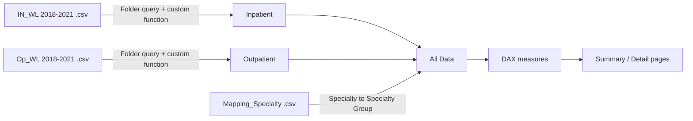

<div align="center">
# 🏥 Hospital Wait List Analytics
### End-to-End Power BI Project | Healthcare Analytics
 


 
*From 8 messy CSV files to a 2-page interactive report: ingestion, cleaning, modelling, DAX, and dashboard design.*
 
</div>
---
 
## 📊 Dashboard Preview
 
**Summary Page**

 
**Detail Page**

 
---
 
## ⚡ TL;DR
 
Patient waiting lists were published as **separate yearly CSVs** for Inpatient/Day Case and Outpatient, with different structures, inconsistent labels, and 70+ specialty names. This project combines them into one clean model and one report that answers: *how long is the queue, who is in it, and how has it changed versus last year?*
 
| Metric | Value |
|---|---|
| 🧾 Rows Modelled | **453,119** |
| 📅 Period Covered | **Jan 2018 – Mar 2021** (39 monthly snapshots) |
| 🩺 Specialties | **78**, grouped into **27** |
| 🏷️ Case Types | Inpatient, Day Case, Outpatient |
| ⏱️ Waiting-Time Bands | 7 (0-3 months to 18+ months) |
 
---
 
## 🔑 What the Data Shows (Mar 2021)
 
- 👥 **708,729** patients on the combined wait list, up about **10.7%** from March 2020 (640,441)
- 🏢 **Outpatient** makes up roughly **89%** of the queue (628,756)
- ⏳ About **27%** of patients (189,370) have waited **18+ months**
- 🦴 Largest specialties: **Orthopaedics (84.9K)**, **ENT (72.4K)**, **General Surgery (58.9K)**, Ophthalmology, Dermatology
---
 
## 🔄 Pipeline
 

 
## 🧹 What I Fixed in Power Query
 
| Issue | Fix |
|---|---|
| Inpatient and Outpatient files had different structures | Built a folder-based query per set with a reusable transform function, so new files drop in automatically |
| Outpatient had no case-type column | Added `Case_Type = "Outpatient"` before combining |
| Specialty name sat in two different columns | Merged into one `Specilality New` field |
| Label mismatch (`18 Months +` vs `18+ Months`) and stray spaces | Replaced and trimmed text |
| Blank age and time-band values | Replaced with `No Inputs` so nothing silently drops out of visuals |
| Dates imported as text | Converted using the `en-GB` locale |
| 78 specialties is too many for a chart | Joined to a mapping table to roll up into 27 groups |
 
## 🧮 DAX Highlights
 
```DAX
-- Latest month vs same month last year
Latest Month Wait List =
CALCULATE ( SUM ( 'All Data'[Total] ), 'All Data'[Archive_Date] = MAX ( 'All Data'[Archive_Date] ) ) + 0
 
PY Latest Month Wait List =
CALCULATE ( SUM ( 'All Data'[Total] ), 'All Data'[Archive_Date] = EDATE ( MAX ( 'All Data'[Archive_Date] ), -12 ) ) + 0
 
-- Let the user flip every KPI between Average and Median
Avg/Med wait list =
SWITCH ( VALUES ( 'Calculation Table'[Calc Method] ),
    "Average", [Avg Wait List],
    "Median",  [Med Waait List] )
 
-- Friendly empty-state message instead of a blank visual
NoDataLeft =
IF ( ISBLANK ( CALCULATE ( SUM ( 'All Data'[Total] ), 'All Data'[Case_Type] <> "Outpatient" ) ),
     "No Data For Selected Criteria", "" )
```
 
**Techniques used:** time intelligence (`EDATE`), a disconnected calculation table with `SWITCH` for a dynamic metric toggle, dynamic card titles, and no-data handling.
 
---
 
## 📑 Report Pages
 
| Page | What it does |
|---|---|
| 📈 **Summary** | Latest month vs prior year, case-type split, time bands by age profile, top 5 specialties, and monthly trend lines (Day Case/Inpatient vs Outpatient) with an Average/Median toggle |
| 🔍 **Detail** | Filterable grid by date, specialty, case type, age profile, and time band |
 
## 📁 Repository Contents
 
| File | Description |
|---|---|
| `End_to_End_Dashboard.pbix` | Full Power BI report with data model and DAX measures |
| `summary_page.png` | Summary page preview |
| `detail_page.png` | Detail page preview |
| `README.md` | This file |
 
> **Note:** the Power Query sources point to local CSV paths, so *Refresh* won't work on another machine. The data is already loaded in the file, so everything is explorable as-is.
 
---
 
<div align="center">
## 👤 About Me
 
**Muhammed Imran K**
Data Analyst | Power BI • Tableau • Python • SQL • Excel
Econometrics Master's Graduate (University Rank Holder), University of Calicut
 
[LinkedIn](https://www.linkedin.com/in/muhammedimrank/)
 
</div>
