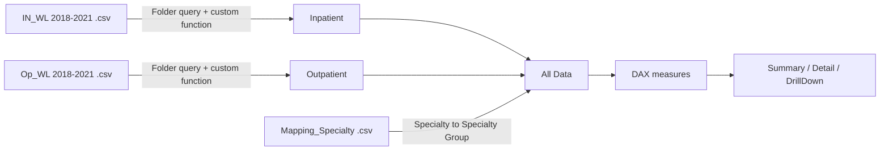

# Hospital Wait List Analytics: End-to-End Power BI Project

**From 8 messy CSV files to a 3-page interactive report.** Ingestion, cleaning, modelling, DAX, and dashboard design, all in one `.pbix`.

`Power Query (M)` · `DAX` · `Star-style modelling` · `Power BI Desktop`

---

## Screenshots

| Summary | Detail | DrillDown |
|---|---|---|
|  |  |  |

---

## The problem

Patient waiting lists were published as **separate yearly CSVs** for Inpatient/Day Case and Outpatient, with different column names, inconsistent labels, and 70+ specialty names. Nobody could see the whole picture in one place.

**Goal:** one model, one report, where a user can see how long the queue is, who is in it, and how it changed versus last year.

## Pipeline



## The data

| | |
|---|---|
| Rows | **453,119** |
| Period | Jan 2018 – Mar 2021 (**39 monthly snapshots**) |
| Case types | Inpatient, Day Case, Outpatient |
| Specialties | **78**, mapped into **27 specialty groups** |
| Dimensions | Age profile, adult/child, 7 waiting-time bands (0-3 months up to 18+ months) |

## What I fixed in Power Query

| Issue | Fix |
|---|---|
| Inpatient and Outpatient files had different structures | Built a folder-based query per set with a reusable transform function, so new files drop in automatically |
| Outpatient had no case-type column | Added `Case_Type = "Outpatient"` before combining |
| Specialty name sat in two different columns | Merged into one `Specilality New` field |
| Label mismatch (`18 Months +` vs `18+ Months`) and stray spaces | Replaced and trimmed text |
| Blank age and time-band values | Replaced with `No Inputs` so nothing silently drops out of visuals |
| Dates imported as text | Converted using the `en-GB` locale |
| 78 specialties is too many for a chart | Joined to a mapping table to roll up into 27 groups |

## DAX highlights

```DAX
-- Latest month vs same month last year
Latest Month Wait List =
CALCULATE ( SUM ( 'All Data'[Total] ), 'All Data'[Archive_Date] = MAX ( 'All Data'[Archive_Date] ) ) + 0

PY Latest Month Wait List =
CALCULATE ( SUM ( 'All Data'[Total] ), 'All Data'[Archive_Date] = EDATE ( MAX ( 'All Data'[Archive_Date] ), -12 ) ) + 0

-- Let the user flip every KPI between Average and Median
Avg/Med wait list =
SWITCH ( VALUES ( 'Calculation Table'[Calc Method] ),
    "Average", [Avg Wait List],
    "Median",  [Med Waait List] )

-- Friendly empty-state message instead of a blank visual
NoDataLeft =
IF ( ISBLANK ( CALCULATE ( SUM ( 'All Data'[Total] ), 'All Data'[Case_Type] <> "Outpatient" ) ),
     "No Data For Selected Criteria", "" )
```

**Techniques used:** time intelligence (`EDATE`), a disconnected calculation table with `SWITCH` for a dynamic metric toggle, dynamic card titles, and no-data handling.

## Report pages

1. **Summary:** latest month vs prior year, case-type split, time bands by age profile, top 5 specialties, and monthly trend lines (Day Case/Inpatient vs Outpatient) with an Average/Median toggle.
2. **Detail:** a filterable grid by date, specialty, case type, age profile, and time band.
3. **DrillDown:** totals by specialty group.

## What the data shows (latest month, Mar 2021)

- **708,729** patients on the combined wait list, up about **10.7%** from March 2020 (640,441)
- **Outpatient** is roughly **89%** of the queue (628,756)
- About **27%** of patients (189,370) have waited **18+ months**
- Largest specialties: **Orthopaedics (84.9K)**, **ENT (72.4K)**, **General Surgery (58.9K)**, Ophthalmology, Dermatology

## Files

| File | What it is |
|---|---|
| `End_to_End_Dashboard.pbix` | Full report with data model |
| `summary_page.png`, `detail_page.png`, `drilldown_page.png` | Page previews |

> **Note:** the Power Query sources point to local CSV paths, so *Refresh* won't work on another machine. The data is already loaded in the file, so everything is explorable as-is.

---

**Muhammed Imran K** · Data Analyst · [LinkedIn](https://www.linkedin.com/in/muhammedimrank/)
